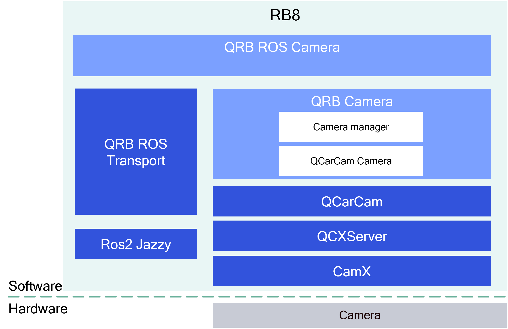

## 👋 Overview

The `QRB ROS Camera` is a ROS package to publish the images from Qualcomm **GMSL** cameras. It provides:

- Concurrent multiple streams output support.
- Composable ROS node support.
- Zero-Copy transport powered by `QRB ROS Transport`  .
- Only support outputs in NV12 format


<div align="center">
  
</div>

<br>

The `qrb_ros_camera` is a ROS 2 package. It creates an image publisher with qrb_ros_transport for zero-copy transport. It supports node composition, making it possible to improve performance using ROS intra-process communication.

The `qrb_camera` is a C++ library, it provides APIs to `qrb_ros_camera` for querying images from the lower layer `QCarCam` library. It includes 2 modules:
- The module `camera_manager` used to manage camera streams, which enables multiple stream support.
- The module `qcarcam_camera` used to call QCarCam APIs to manage camera streams and handle frame delivery via DMA-heap buffers.

The `qrb_ros_transport` is a ROS 2 package, it supports zero-copy image transport with Linux DMA buffer and implements ROS type adaption, make it compatible with both intra- and inter-process communication.

The `QCarCam` (Qualcomm Camera Client) is the Qualcomm camera framework, it exports APIs for accessing Qualcomm camera hardware via the QCX camera service.

## 🔎 Table of contents
  * [APIs](#-apis)
     * [`qrb_ros_camera` APIs](#-qrb_ros_camera-apis)
     * [`qrb_camera` APIs](#-qrb_camera-apis)
  * [Supported targets](#-supported-targets)
  * [Installation](#-installation)
  * [Usage](#-usage)
     * [Starting the camera node](#start-the-camera-node)
     * [Enable mutiple streams](#enable-multiple-streams)
     * [Enable zero copy transport](#enable-zero-copy-transport)
  * [Build from source](#-build-from-source)
  * [Contributing](#-contributing)
  * [Contributors](#%EF%B8%8F-contributors)
  * [FAQs](#-faqs)
  * [License](#-license)

## ⚓ APIs

### 🔹 `qrb_ros_camera` APIs

#### ROS interfaces

<table>
  <tr>
    <th>Interface</th>
    <th>Name</th>
    <th>Type</th>
    <td>Description</td>
  </tr>
  <tr>
    <td>Publisher</td>
    <td>/cam${camera_id}_${stream_name}</td>
    <td>qrb_ros::transport::type::Image</td>
    <td>output image (zero-copy DMA-buf)</td>
  </tr>
  <tr>
    <td></td>
    <td>/cam${camera_id}_${stream_name}_camera_info</td>
    <td>sensor_msgs/msg/CameraInfo</td>
    <td>camera information (per stream)</td>
  </tr>
</table>

#### ROS parameters

<table>
  <tr>
    <th>Name</th>
    <th>Type</th>
    <th>Description</td>
    <th>Default Value</td>
  </tr>
  <tr>
    <td>camera_id</td>
    <td>int64</td>
    <td>The camera device ID (QCarCam inputId)</td>
    <td>0</td>
  </tr>
  <tr>
    <td>stream_size</td>
    <td>uint64</td>
    <td>Count of camera streams</td>
    <td>1</td>
  </tr>
  <tr>
    <td>stream_name</td>
    <td>string[]</td>
    <td>camera stream names</td>
    <td>["stream1"]</td>
  </tr>
  <tr>
    <td>${stream_name}.width</td>
    <td>uint32</td>
    <td>image width</td>
    <td>1280</td>
  </tr>
  <tr>
    <td>${stream_name}.height</td>
    <td>uint32</td>
    <td>image height</td>
    <td>720</td>
  </tr>
  <tr>
    <td>${stream_name}.fps</td>
    <td>uint32</td>
    <td>output image frequency(Hz)</td>
    <td>30</td>
  </tr>
  <tr>
    <td>camera_info_path</td>
    <td>string</td>
    <td>Camera intrinsic parameters YAML file path</td>
    <td>config/camera_info_OX03F10_yuv.yaml</td>
  </tr>
  <tr>
    <td>dump</td>
    <td>bool</td>
    <td>Dump received frames to disk (debug only)</td>
    <td>false</td>
  </tr>
</table>

> [!Note]
> The parameter values should be set according to the actual camera hardware capabilities.

### 🔹 `qrb_camera` APIs

<table>
  <tr>
    <th>Function</th>
    <th>Parameters</th>
    <th>Description</th>
  </tr>
  <tr>
    <td>int create_camera(CameraType type, uint32_t camera_id)</td>
    <td>type: camera type, camera_id: camera id</td>
    <td>Creates a camera and returns the camera index on success.</td>
  </tr>
  <tr>
    <td>bool set_camera_parameter(int index, CameraConfigure & param)</td>
    <td>index: camera index, param: camera parameters</td>
    <td>Returns true when the camera parameters are set successfully.</td>
  </tr>
  <tr>
    <td>bool start_camera(int index)</td>
    <td>index: camera index</td>
    <td>Starts the camera. Returns true when started successfully.</td>
  </tr>
  <tr>
    <td>void stop_camera(int index)</td>
    <td>index: camera index</td>
    <td>Stop the camera.</td>
  </tr>
  <tr>
    <td>bool register_callback(int index, ImageCallback image_cb)</td>
    <td>index: camera index, image_cb: callback invoked for each new frame</td>
    <td>Registers the callback for image frames. The callback receives a <code>std::unique_ptr&lt;CameraFrame&gt;</code> per frame.</td>
  </tr>
</table>

> [!Note]
> The parameter values should be set according to the actual camera hardware capabilities.

## 🎯 Supported targets

<table>
  <tr>
    <th>Development Hardware</th>
    <td>RRD</td>
  </tr>
  <tr>
    <th>GMSL Camera Support</th>
    <td><li>LI-VENUS-OX03F10-96717-120H</li></td>
  </tr>
</table>

---

## 🚀 Usage
### Check whether the camera devices have been detected and obtain the corresponding camera_id
```bash
journalctl -b |grep -i input_
```

### Start the camera node
```bash
source /opt/ros/jazzy/setup.bash
ros2 launch qrb_ros_camera qrb_ros_camera_launch.py
```

When using this launch script, it will use the default parameters:

```py
parameters=[{
    'camera_id': 0,
    'stream_size': 1,
    'stream_name': ['stream1'],
    'stream1.height': 720,
    'stream1.width':  1280,
    'stream1.fps':    30,
    'camera_info_path': os.path.join(
        get_package_share_directory('qrb_ros_camera'),
        'config', 'camera_info_OX03F10_yuv.yaml'),
}]
```

It opens camera `0`, with `1` stream, using a resolution of `1280 x 720`, and outputs image at `30` Hz.

You can override defaults via launch arguments:

```bash
ros2 launch qrb_ros_camera qrb_ros_camera_launch.py camera_id:=6 width:=1824 height:=1536 fps:=30
```

The output for these commands:

```bash
[INFO] [launch]: All log files can be found below /home/ubuntu/.ros/log/...
[INFO] [launch]: Default logging verbosity is set to INFO
[INFO] [component_container-1]: process started with pid [...]
[component_container-1] [INFO] [...] [camera_container]: Load Library: /opt/ros/jazzy/lib/libcamera_node.so
[component_container-1] [INFO] [...] [camera_node]: QRB Camera Node start
[component_container-1] [INFO] [...] [camera_node]: load camera intrinsic param
[component_container-1] [INFO] [...] [camera_node]: system time: ... ros time: ... time offset: ... ns
[component_container-1] [INFO] [...] [camera_node]: QRB Camera Node init success
...
```

Then you can check ROS topics or view image with the topic `/cam${camera_id}_${stream_name}` in RVIZ or RQT.

```bash
ros2 topic list
/cam0_stream1
/cam0_stream1_camera_info
```

### Enable zero copy transport

The `qrb_ros_camera` supports directly sharing image `dmabuf_fd` between nodes, which can avoid image data memory copy with DDS.

For detail about this feature, see https://docs.ros.org/en/rolling/Concepts/Intermediate/About-Composition.html

We recommend using `launch` to compose multiple nodes:

```python
def generate_launch_description():
    container = ComposableNodeContainer(
        name='camera_container',
        namespace='',
        package='rclcpp_components',
        executable='component_container',
        composable_node_descriptions=[
            ComposableNode(
                package='qrb_ros_camera',
                plugin='qrb_ros::camera::CameraNode',
                name='camera_node',
                parameters=[{
                    # ...
                }]
            ),
            ComposableNode(
                package='qrb_ros_camera',
                plugin='qrb_ros::camera::TestNode',
                name='test',
                remappings=[
                    ('/image',       '/cam0_stream1'),
                    ('/camera_info', '/cam0_stream1_camera_info'),
                ],
            )
        ],
        output='screen',
    )

    return launch.LaunchDescription([container])
```

---

## 👨‍💻 Build from source

```bash
cd <workspace>
./build-utils/ubuntu/build.py --gen-debians --package ros-jazzy-qrb-camera
./build-utils/ubuntu/build.py --gen-debians --package ros-jazzy-qrb-ros-camera
```
Built `.deb` files are output to:
```bash
<workspace>/debian_packages/oss/ros-jazzy-qrb-camera
<workspace>/debian_packages/oss/ros-jazzy-qrb-ros-camera
```

Check whether the camera devices have been detected and obtain the corresponding camera_id
```bash
journalctl -b |grep -i input_
```
Run and debug
```bash
source /opt/ros/jazzy/setup.bash
ros2 launch qrb_ros_camera qrb_ros_camera_launch.py camera_id:=<camera_id> width:=<width> height:=<height> fps:=<fps>
```

## 📜 License

Project is licensed under the [BSD-3-Clause](https://spdx.org/licenses/BSD-3-Clause.html) License. See [LICENSE](./LICENSE) for the full license text.
